# obsidian-agent-kb

**English** | [简体中文](README.zh-CN.md)

A template for an **explainer-article knowledge base** in Obsidian that is written and maintained by **Claude Code agents**.

Instead of loose notes, the vault holds long-form articles that each answer one question at textbook depth: H2 sections split into H3 subsections, callout cards for definitions, results and derivations, numbered key equations, figures computed from Python scripts, citations to literature notes and links to atomic term cards. Series maps are generated from the articles, and a dashboard on the home note shows the learning path, your reading progress and a searchable library. A Claude Code skill, `kb-notes`, packages the workflows that keep all of this consistent: optimising notes, writing new articles, coordinating parallel agents and checking cross-references.

The repository ships a small but complete sample series, *Damped and driven oscillations* (3 articles, 4 figures, 8 term cards, 2 literature notes), so the dashboard works the moment you open the vault.

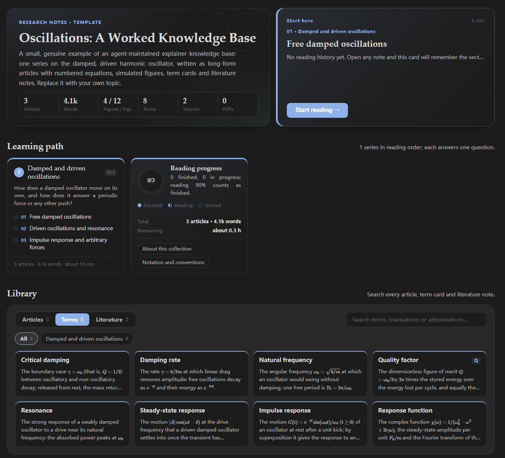

*The home dashboard of the sample vault, screenshot taken in Obsidian (default dark theme): hero with statistics, start/continue-reading card, learning path with read status, and the searchable library (here on the Terms tab).*

## What it looks like

**An article in Obsidian.** Callout cards for definitions, propositions and derivations, numbered key equations, and a figure card whose PNG is computed by a script in `90 System/figure-scripts/`, with a one-line paper-style caption.

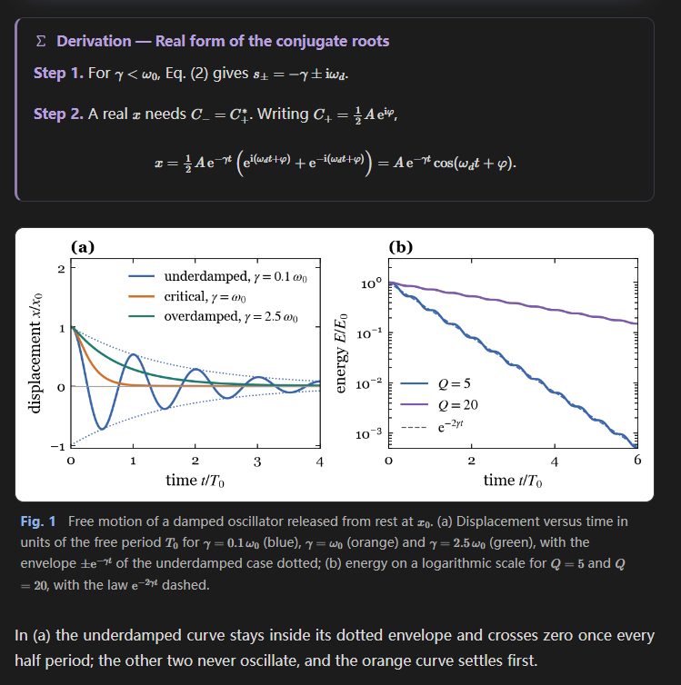

*Screenshot taken in Obsidian (default dark theme), article "Free damped oscillations".*

<table>
<tr>
<td width="50%">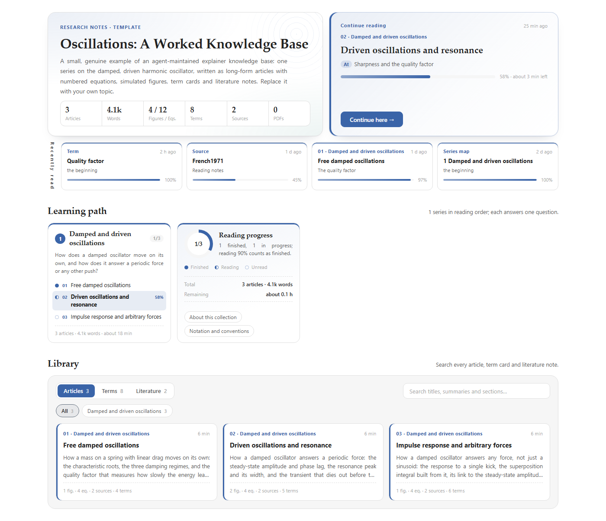</td>
<td width="50%">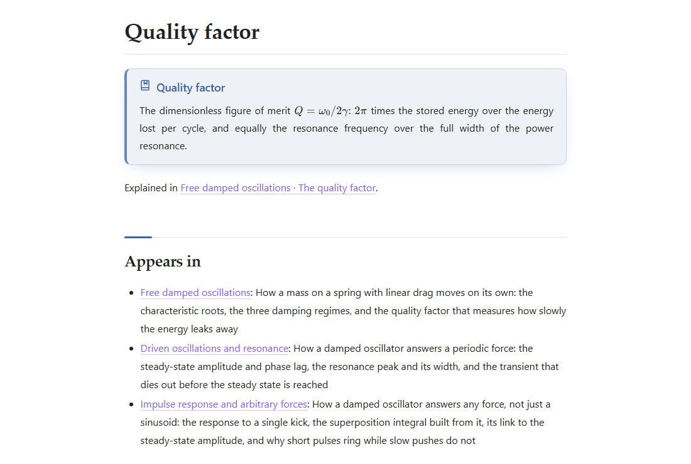</td>
</tr>
<tr>
<td><em>Home dashboard in light mode with a simulated reading history (continue-reading card, recently read row, read-status dots). Preview-harness render.</em></td>
<td><em>A term card: one-sentence definition, the article that explains it, and the Dataview "Appears in" list. Preview-harness render.</em></td>
</tr>
</table>

**Link graph.** Articles link to the term cards they use and to the literature they cite; series maps and front notes tie the articles together.

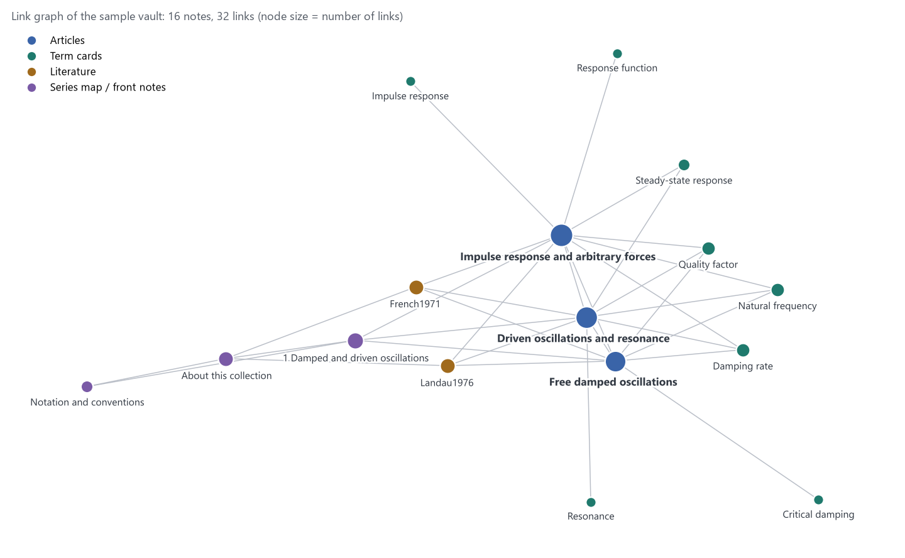

**Computed figures.** Every figure in the sample series comes from `90 System/figure-scripts/oscillator.py` with the shared house style of `figstyle.py`:

| Free motion and energy decay | Resonance curves | Start-up transient | Impulse response |
|---|---|---|---|
| 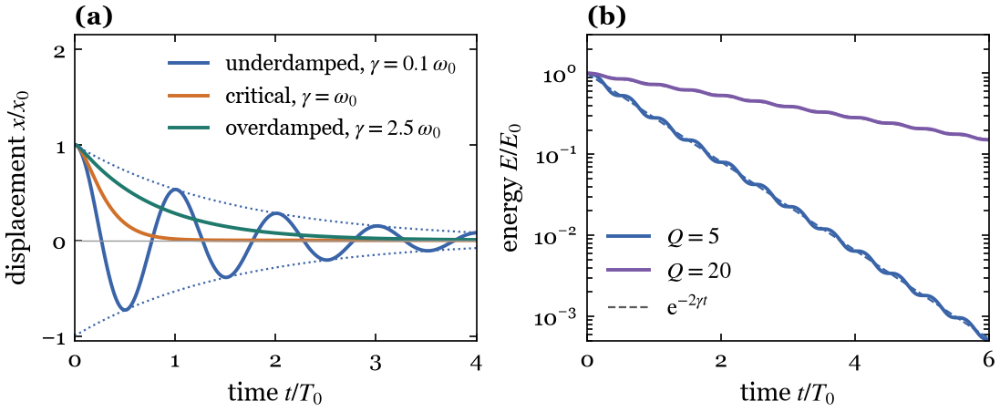 | 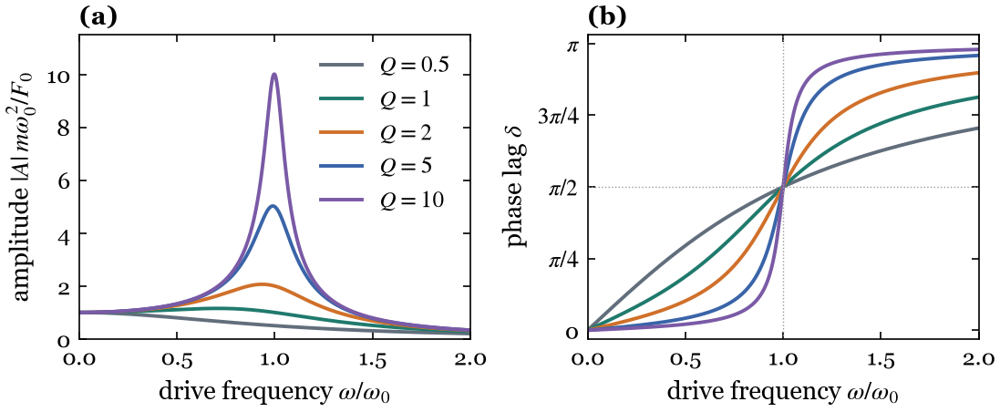 | 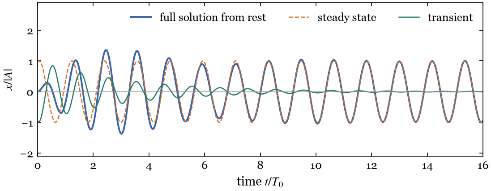 | 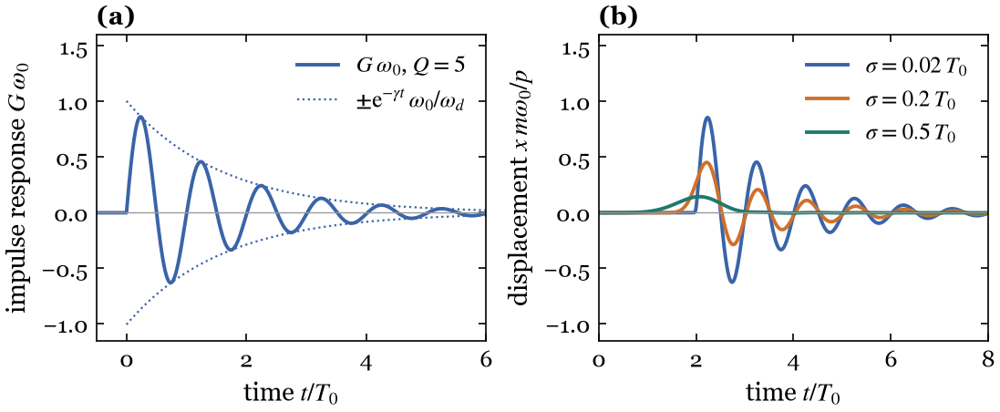 |

<sub>How these images were made: the two `obsidian-*.png` images are screenshots taken in Obsidian. The light-mode home and the term card are not Obsidian screenshots: they are rendered from the vault's own `view.js` and CSS by [`docs/preview/shoot.ps1`](docs/preview/shoot.ps1) in headless Microsoft Edge, on a small Dataview stand-in with an invented reading history, approximating Obsidian's default theme (KaTeX instead of MathJax, approximate fonts and spacing). The link graph is drawn with matplotlib from the notes' wiki links by `docs/preview/graph.py`; it is not Obsidian's graph view.</sub>

## How it is organised

A **series map** poses one question and lists its articles in reading order. Each **article** answers one sub-question and links to the **term cards** it defines or uses, the **literature notes** it cites and the **figures** its script computes. The dashboard and the series maps are generated from frontmatter, so adding an article updates both.

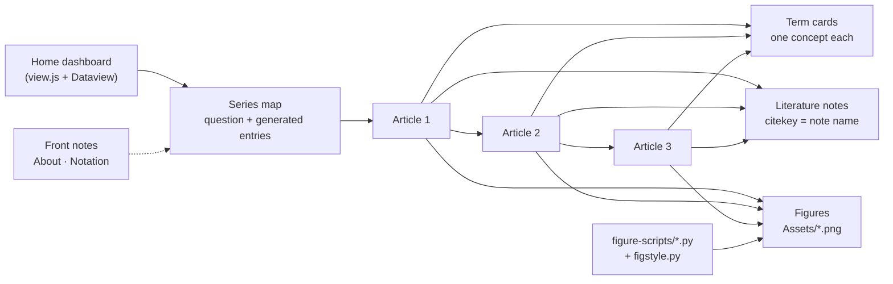

Agents work in the loop below (see [docs/agent-workflow.md](docs/agent-workflow.md)). One coordinating Claude Code session plans and writes briefs; execution agents each own exactly one note; the coordinator integrates their reports and runs the checks before the series maps are regenerated.

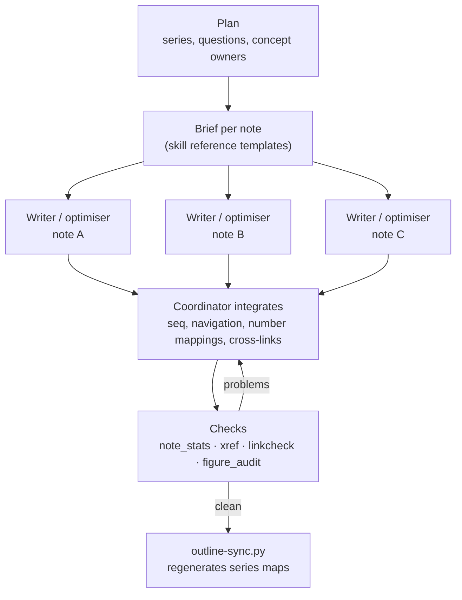

## Quick start

1. **Clone** the repository (or use it as a GitHub template):
   ```
   git clone https://github.com/<you>/obsidian-agent-kb.git
   ```
2. **Open the folder as a vault** in Obsidian: *Open another vault → Open folder as vault →* select `obsidian-agent-kb`.
3. **Trust the author and enable community plugins** when Obsidian asks. The vault bundles exactly two: Dataview (renders the dashboard and the lists in term and literature notes) and the local plugin KB Open Home (opens Home at startup and remembers where you stopped reading).
4. **Home opens.** If it does not on first launch, reopen the vault or run the command *KB Open Home: Open home*.

The CSS snippets `kb-article` and `kb-home` are enabled in `.obsidian/appearance.json`. Any theme works; the look was tuned on the default theme and on Minimal.

## Requirements

- **Obsidian ≥ 1.5** (desktop or mobile; reading-position tracking works on both).
- **Python 3** for the maintenance scripts (standard library only) and **matplotlib + numpy** for the figure scripts.
- **Claude Code** for the agent workflows.

## Install the `kb-notes` skill

The skill lives in `.claude/skills/kb-notes/` (`SKILL.md`, reference briefs and the conventions template, and the checker scripts `xref.py`, `linkcheck.py`, `note_stats.py`, and `figure_audit.py`, which checks that every figure panel is explained individually).

- **Project-local:** nothing to do. Start Claude Code in the vault folder and the skill is available there; `CLAUDE.md` tells the agent to use it.
- **Global** (use it with any vault built on this template):
  ```
  cp -r .claude/skills/kb-notes ~/.claude/skills/
  ```
  On Windows: `xcopy /E /I .claude\skills\kb-notes %USERPROFILE%\.claude\skills\kb-notes`.

Then ask Claude Code things like "optimise the article Free damped oscillations", "write a new article on coupled oscillators with term cards" or "check all cross-references". See [docs/agent-workflow.md](docs/agent-workflow.md) for a step-by-step tutorial.

## Rename, translate, make it yours

Everything the code needs to know about the vault is in `90 System/kb.config.json`:

- `title`, `eyebrow`, `lede` — the dashboard hero;
- `folders` — folder names; `types` — frontmatter `type` values; `home` — the home note;
- `front_notes` — the two front notes shown as chips on the dashboard;
- `labels` — the words for equation / figure / table references (`Eq. (3)`, `Fig. 2`);
- `reading` — words per minute, word unit and sort locale; `outline` — series-map formatting;
- `ui` — every string shown by the dashboard and the KB Open Home plugin.

`90 System/home/view.js`, `90 System/outline-sync.py` and the plugin read all of these, so a translation is a config edit. [docs/examples/kb.config.zh.json](docs/examples/kb.config.zh.json) shows a complete Chinese setup. When you rename folders or types, also rename the folders on disk, update the `type:` values of existing notes, the `FROM "…"` / `type = "…"` lines in the Dataview blocks of term and literature notes and templates, the graph colour groups in `.obsidian/graph.json`, and the labels in `90 System/CONVENTIONS.md`. Reload Obsidian afterwards so the plugin's command names pick up the new strings.

To start your own topic, delete the sample notes in `10 Series`, `20 Articles`, `30 Terms`, `40 Literature`, the PNGs in `Assets/oscillator/` and `90 System/figure-scripts/oscillator.py`, rewrite the two front notes, create a series map from `Templates/Series map.md`, and let an agent write the first article.

## Repository layout

```
obsidian-agent-kb/
├── Home.md                          dashboard note (one dataviewjs call)
├── 10 Series/                       series maps + front notes
│   ├── 1 Damped and driven oscillations.md
│   ├── About this collection.md
│   └── Notation and conventions.md
├── 20 Articles/                     long-form explainer articles
├── 30 Terms/                        atomic term cards
├── 40 Literature/                   one note per cited work (citekey = note name)
├── Assets/oscillator/               PNGs written by the figure scripts
├── 90 System/
│   ├── kb.config.json               folders, types, labels, UI strings
│   ├── CONVENTIONS.md               writing and markup rules for this vault
│   ├── outline-sync.py              regenerates series maps from articles
│   ├── home/view.js                 dashboard (Dataview JS)
│   └── figure-scripts/              figstyle.py, oscillator.py, README.md
├── Templates/                       Article, Term card, Literature, Series map
├── .obsidian/
│   ├── snippets/                    kb-article.css, kb-home.css
│   └── plugins/                     dataview (MIT, bundled), kb-open-home (local)
├── .claude/skills/kb-notes/         the Claude Code skill
├── docs/                            agent-workflow.md, conventions.md, examples/,
│                                    images/ (README images), preview/ (render harness)
├── CLAUDE.md                        instructions for agents working in this vault
└── LICENSE                          MIT
```

## License

MIT, see [LICENSE](LICENSE). The bundled Dataview plugin is © Michael Brenan, MIT licensed (`.obsidian/plugins/dataview/LICENSE`). The sample literature notes contain bibliographic data only; no copyrighted text or PDFs are included.
