# obsidian-agent-kb

[English](README.md) | **简体中文**

一个在 Obsidian 中搭建**解读文章型知识库**的模板，内容由 **Claude Code 智能体（agent）**撰写和维护。

库里放的不是零散笔记，而是一篇篇长文，每篇以教科书的深度回答一个问题：H2 章节下分 H3 小节，定义、结论和推导写成 callout 卡片，关键公式统一编号，图由 Python 脚本计算生成，引用指向文献笔记，概念链接到原子化的术语卡片。系列导读由文章自动生成，主页上的仪表盘展示学习路线、阅读进度和可检索的资料库。Claude Code 技能 `kb-notes` 把维护这一切所需的工作流打包在一起：优化笔记、撰写新文章、协调并行智能体、检查交叉引用。

仓库自带一个小而完整的示例系列 *Damped and driven oscillations*（阻尼振动与受迫振动；3 篇文章、4 张图、8 张术语卡片、2 篇文献笔记），打开库的那一刻仪表盘就能正常工作。

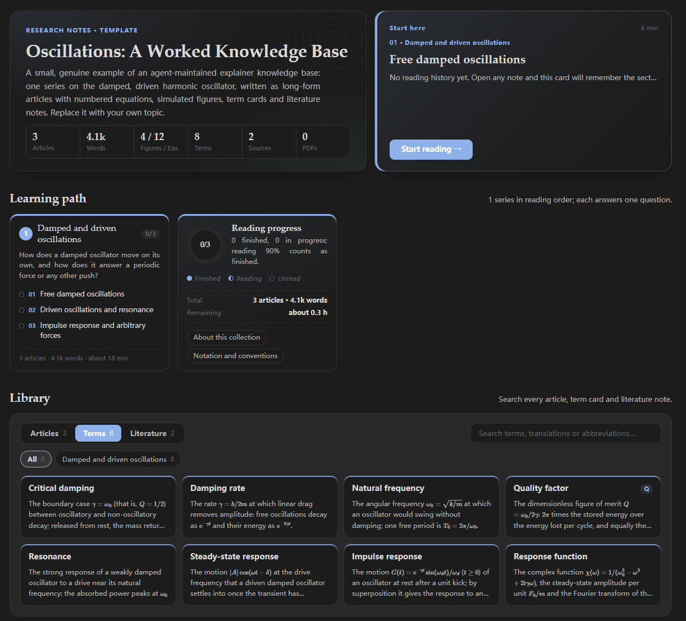

*示例库的主页仪表盘，截图取自 Obsidian（默认深色主题）：带统计数字的顶部横幅、开始/继续阅读卡片、标出阅读状态的学习路线，以及可检索的资料库（图中为“术语”标签页）。*

## 效果展示

**Obsidian 中的一篇文章。** 定义、命题和推导写成 callout 卡片，关键公式带编号；图卡片里的 PNG 由 `90 System/figure-scripts/` 中的脚本计算生成，配一行论文风格的图注。

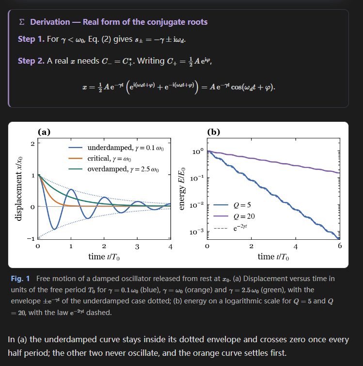

*截图取自 Obsidian（默认深色主题），文章 “Free damped oscillations”（自由阻尼振动）。*

<table>
<tr>
<td width="50%">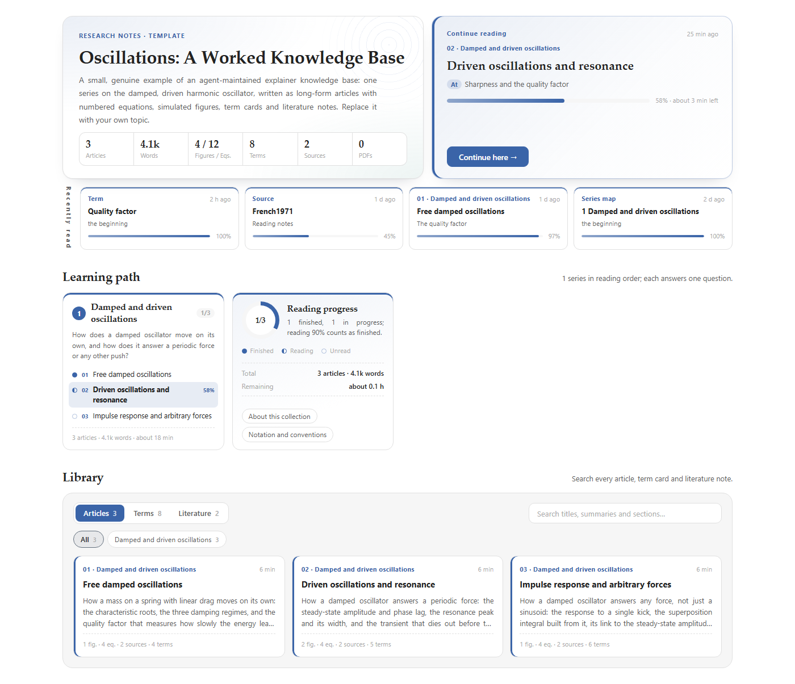</td>
<td width="50%">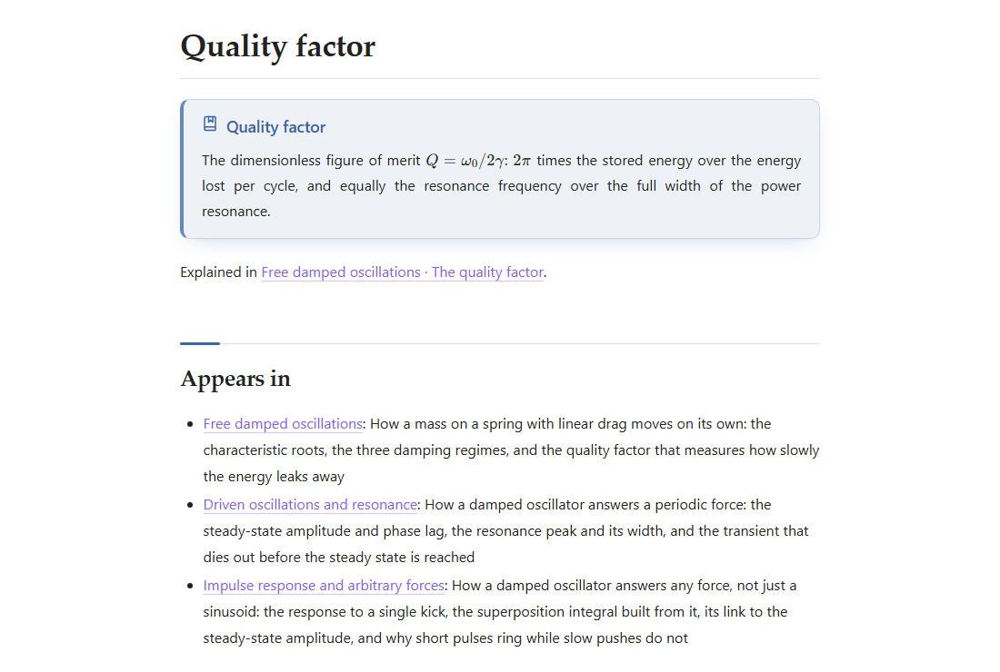</td>
</tr>
<tr>
<td><em>浅色模式下的主页仪表盘，带一段模拟的阅读记录（继续阅读卡片、最近阅读一栏、阅读状态圆点）。由预览工具渲染。</em></td>
<td><em>一张术语卡片：一句话定义、讲解该概念的文章，以及 Dataview 生成的“出现于”列表。由预览工具渲染。</em></td>
</tr>
</table>

**链接关系图。** 文章链接到它用到的术语卡片和它引用的文献；系列导读和系列说明笔记把各篇文章串在一起。

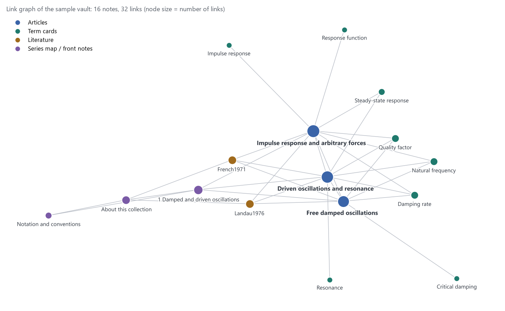

**计算生成的图。** 示例系列中的每张图都来自 `90 System/figure-scripts/oscillator.py`，统一使用 `figstyle.py` 中的样式：

| 自由运动与能量衰减 | 共振曲线 | 起振暂态 | 冲激响应 |
|---|---|---|---|
| 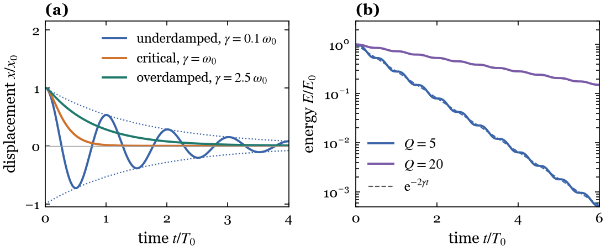 | 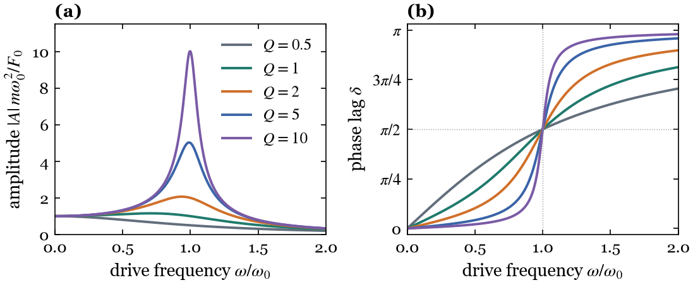 | 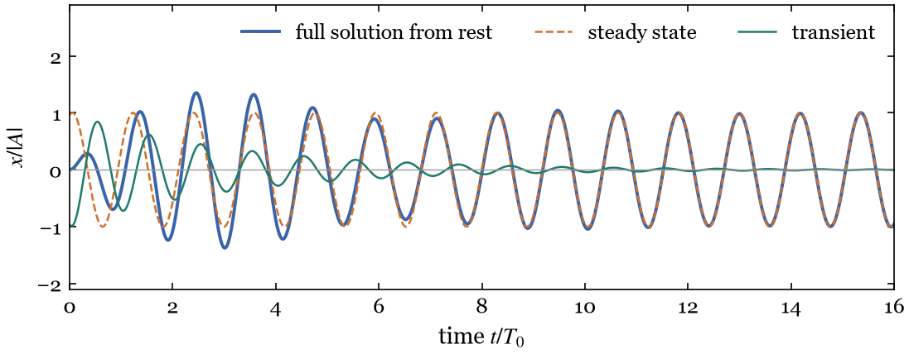 | 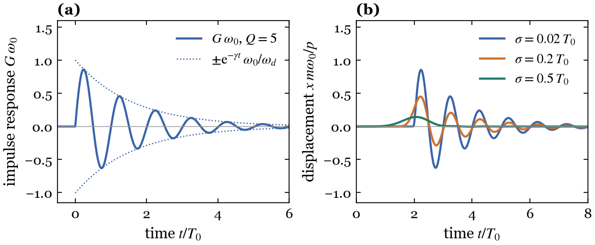 |

<sub>这些图片是怎么来的：两张 `obsidian-*.png` 是在 Obsidian 中截的图。浅色主页和术语卡片不是 Obsidian 截图，而是由 [`docs/preview/shoot.ps1`](docs/preview/shoot.ps1) 在无头 Microsoft Edge 中，用库自身的 `view.js` 和 CSS 渲染出来的：数据来自一个简易的 Dataview 替身和虚构的阅读记录，外观近似 Obsidian 默认主题（用 KaTeX 代替 MathJax，字体和间距是近似的）。链接关系图由 `docs/preview/graph.py` 根据笔记中的维基链接用 matplotlib 绘制，并不是 Obsidian 的关系图视图。</sub>

## 组织方式

一篇**系列导读**提出一个问题，并按阅读顺序列出它的文章。每篇**文章**回答一个子问题，并链接到它定义或用到的**术语卡片**、它引用的**文献笔记**，以及由脚本计算出的**图**。仪表盘和系列导读都由 frontmatter 生成，所以新增一篇文章，两处都会随之更新。

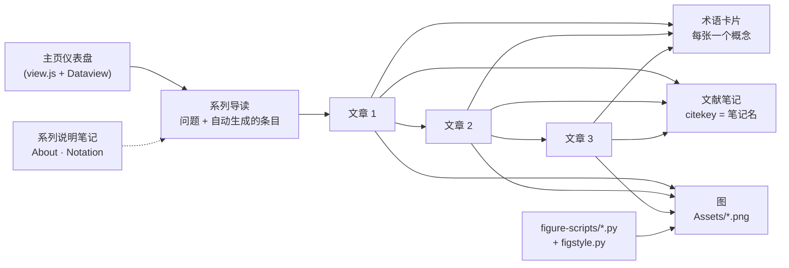

智能体按下面的循环工作（详见 [docs/agent-workflow.md](docs/agent-workflow.md)，英文）。一个负责协调的 Claude Code 会话做规划、写任务说明（brief）；每个执行智能体只负责一篇笔记；协调者汇总它们的报告并运行检查，然后才重新生成系列导读。

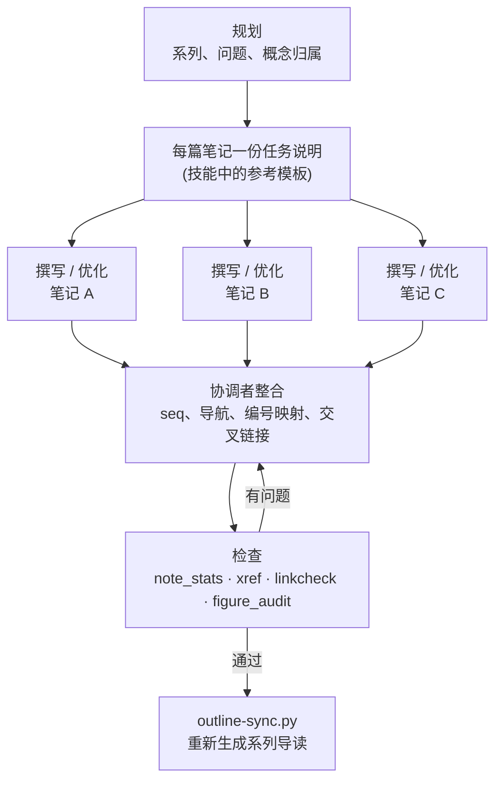

## 快速上手

1. **克隆**仓库（或将它用作 GitHub 模板）：
   ```
   git clone https://github.com/<you>/obsidian-agent-kb.git
   ```
2. **在 Obsidian 中把文件夹作为库打开**：*打开其他库 → 打开本地文件夹作为库 →* 选择 `obsidian-agent-kb`。
3. Obsidian 询问时，**信任作者并启用第三方插件**。库里恰好自带两个插件：Dataview（渲染仪表盘以及术语、文献笔记中的列表）和本地插件 KB Open Home（启动时打开主页，并记住你读到哪里）。
4. **主页会自动打开。** 如果首次启动时没有打开，重新打开库，或运行命令 *KB Open Home: Open home*。

CSS 片段 `kb-article` 和 `kb-home` 已在 `.obsidian/appearance.json` 中启用。任何主题都能用；外观是在默认主题和 Minimal 主题上调校的。

> **想要全中文的库？** 用 [docs/examples/kb.config.zh.json](docs/examples/kb.config.zh.json) 替换 `90 System/kb.config.json`，即可把整个库本地化为中文：文件夹名（如 `20 解读文章`、`30 术语卡片`）、笔记类型、公式/图/表的引用标签（式、图、表）以及仪表盘上的全部文字。具体还要改哪些地方，见下文[重命名、翻译、改成你自己的](#重命名翻译改成你自己的)。

## 环境要求

- **Obsidian ≥ 1.5**（桌面端或移动端；阅读位置记录在两端都可用）。
- **Python 3**，用于维护脚本（只用标准库）；图脚本还需要 **matplotlib + numpy**。
- **Claude Code**，用于智能体工作流。

## 安装 `kb-notes` 技能

技能位于 `.claude/skills/kb-notes/`（包括 `SKILL.md`、参考任务说明与规范模板，以及检查脚本 `xref.py`、`linkcheck.py`、`note_stats.py`，以及检查每个子图是否被单独讲解的 `figure_audit.py`）。

- **项目内使用：** 无需任何操作。在库文件夹中启动 Claude Code，技能即可使用；`CLAUDE.md` 会让智能体调用它。
- **全局安装**（在任何基于本模板的库中使用）：
  ```
  cp -r .claude/skills/kb-notes ~/.claude/skills/
  ```
  Windows 上：`xcopy /E /I .claude\skills\kb-notes %USERPROFILE%\.claude\skills\kb-notes`。

然后就可以对 Claude Code 说 “optimise the article Free damped oscillations”“write a new article on coupled oscillators with term cards” 或 “check all cross-references” 之类的话。技能也能识别中文请求，例如“优化笔记”“新写一篇文章”“检查交叉引用”。分步教程见 [docs/agent-workflow.md](docs/agent-workflow.md)（英文）。

## 重命名、翻译、改成你自己的

代码需要知道的关于库的一切，都写在 `90 System/kb.config.json` 中：

- `title`、`eyebrow`、`lede`：仪表盘顶部横幅；
- `folders`：文件夹名；`types`：frontmatter 中的 `type` 取值；`home`：主页笔记；
- `front_notes`：在仪表盘上以标签形式显示的两篇系列说明笔记；
- `labels`：公式、图、表引用所用的词（`Eq. (3)`、`Fig. 2`；中文配置下为“式 (3)”“图 2”）；
- `reading`：每分钟阅读字数、字数单位和排序语言区域；`outline`：系列导读的格式；
- `ui`：仪表盘和 KB Open Home 插件显示的所有文字。

`90 System/home/view.js`、`90 System/outline-sync.py` 和插件都从这里读取配置，所以翻译只需改配置。[docs/examples/kb.config.zh.json](docs/examples/kb.config.zh.json) 给出了一份完整的中文配置。重命名文件夹或类型时，还要同步修改：磁盘上的文件夹名、已有笔记的 `type:` 值、术语和文献笔记及模板里 Dataview 代码块中的 `FROM "…"` / `type = "…"` 行、`.obsidian/graph.json` 中的关系图配色分组，以及 `90 System/CONVENTIONS.md` 中的标签。改完后重新加载 Obsidian，插件的命令名才会换成新文字。

要开始你自己的主题，删除 `10 Series`、`20 Articles`、`30 Terms`、`40 Literature` 中的示例笔记，`Assets/oscillator/` 中的 PNG 以及 `90 System/figure-scripts/oscillator.py`，重写两篇系列说明笔记，用 `Templates/Series map.md` 新建一篇系列导读，然后让智能体写出第一篇文章。

## 仓库结构

```
obsidian-agent-kb/
├── Home.md                          仪表盘笔记（一次 dataviewjs 调用）
├── 10 Series/                       系列导读 + 系列说明笔记
│   ├── 1 Damped and driven oscillations.md
│   ├── About this collection.md
│   └── Notation and conventions.md
├── 20 Articles/                     长篇解读文章
├── 30 Terms/                        原子化术语卡片
├── 40 Literature/                   每篇被引文献一篇笔记（citekey = 笔记名）
├── Assets/oscillator/               图脚本输出的 PNG
├── 90 System/
│   ├── kb.config.json               文件夹、类型、标签、界面文字
│   ├── CONVENTIONS.md               本库的写作与标记规范
│   ├── outline-sync.py              根据文章重新生成系列导读
│   ├── home/view.js                 仪表盘（Dataview JS）
│   └── figure-scripts/              figstyle.py、oscillator.py、README.md
├── Templates/                       文章、术语卡片、文献、系列导读模板
├── .obsidian/
│   ├── snippets/                    kb-article.css、kb-home.css
│   └── plugins/                     dataview（MIT，随库附带）、kb-open-home（本地）
├── .claude/skills/kb-notes/         Claude Code 技能
├── docs/                            agent-workflow.md、conventions.md（英文）、examples/、
│                                    images/（README 图片）、preview/（渲染工具）
├── CLAUDE.md                        给在本库中工作的智能体的说明
└── LICENSE                          MIT
```

## 许可证

MIT，见 [LICENSE](LICENSE)。随库附带的 Dataview 插件版权归 Michael Brenan 所有，采用 MIT 许可（`.obsidian/plugins/dataview/LICENSE`）。示例文献笔记只包含书目信息，不含任何受版权保护的正文或 PDF。
